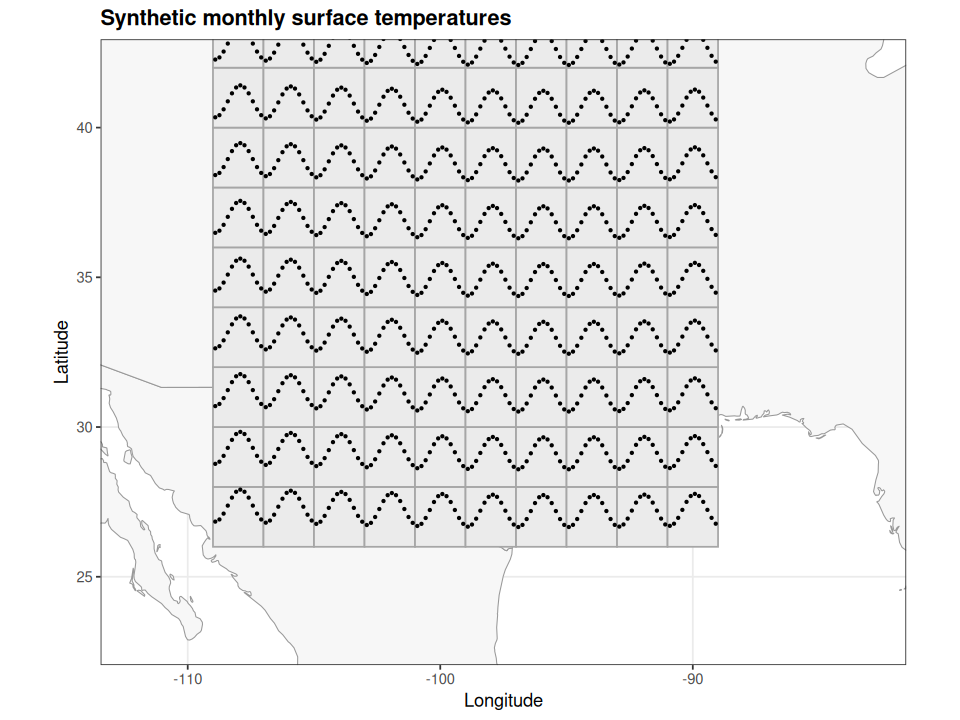

# ggsubplot

[](https://github.com/ncray/ggsubplot/actions/workflows/R-CMD-check.yaml)

A modernization fork of [Garrett Grolemund and Hadley Wickham’s ggsubplot](https://github.com/garrettgman/ggsubplot), maintained by [ncray](https://github.com/ncray).
The original authors and RStudio retain their attribution. This fork is independent
and does not imply their endorsement.

## Release status

The plotting tests pass on R 4.6.1 with ggplot2 4.0.3 and 3.5.2. The maintainer uses a GitHub noreply address to keep personal email private.
Local package builds and standard offline checks pass on both versions with
zero errors, warnings, or notes. The badge above links to the public CI matrix;
check its results for cross-platform status. See
[RELEASE_CHECKLIST.md](RELEASE_CHECKLIST.md).

## Installation

Requires R >= 4.1 and ggplot2 >= 3.5.2. Install this fork from GitHub:

```r
install.packages("remotes")
remotes::install_github("ncray/ggsubplot", build_vignettes = TRUE)
```

This is a GitHub development release, not a new CRAN release. See
[NEWS.md](NEWS.md) for differences from the historical package.

## Example

`nasa` and `casualties` now contain entirely synthetic examples, generated
independently without using the original records. Their historical names and
columns are retained for compatibility; they are not real NASA or war data.
Reproduce them with `Rscript tools/generate-synthetic-data.R`.


Embed small ggplot2 layers in a larger plot to explore spatial, grouped, or
hierarchical data. Version 0.4.0 works with ggplot2 3.5.2 and 4.0.x using ordinary
layers: no special plot class or print method is needed.

```r
library(ggplot2)
library(ggsubplot)

n <- subset(nasa, year == 1995 & long > -110 & long < -85 & lat > 25 & lat < 45)
p <- ggplot(n)
if (requireNamespace("maps", quietly = TRUE)) {
  background <- map_data("world", region = c("USA", "Mexico"))
  p <- p + geom_polygon(data = background, aes(long, lat, group = group),
    inherit.aes = FALSE, fill = "grey97", colour = "grey60")
}
p + geom_subplot(aes(long, lat, group = id),
    subplot = geom_point(aes(month, surftemp), size = 0.55),
    width = 2, height = 2, reference = ref_box()) +
  coord_quickmap(xlim = c(-112, -83), ylim = c(23, 42)) +
  theme_bw() + labs(x = "Longitude", y = "Latitude")
```



`geom_subplot2d()` bins locations into a grid. `geom_star()`, `geom_freqstar()`,
and `geom_coxcomb()` provide radial glyphs. Minor limits are shared by default;
`x_scale = free` and `y_scale = free` normalize each subplot separately.
Expressions such as `fill = mean(surftemp)` evaluate per subplot; `ply.aes`
controls this behavior. The historical `aes(subplot = geom_point(...))`
spelling also works.

Read `vignette("manual", package = "ggsubplot")` for grid breaks, references,
legends, and migration details. Outer facets and nested subplots are unsupported.
See [NEWS.md](NEWS.md) for breaking changes and
[MODERNIZATION_NOTES.md](MODERNIZATION_NOTES.md) for validation results.

For development, run `Rscript -e 'testthat::test_local()'`. The gallery uses nine
vdiffr cases with version-specific snapshots. Reproduce the reviewed PNGs with
`Rscript tools/render-gallery.R`; run again with `R_LIBS=/opt/gg35` in the supplied
development container to generate the compatibility gallery. No network is
needed to render the examples or vignette.

## Attribution and licensing

The package code retains upstream’s **GPL-2.0-or-later** license.
See [COPYING](COPYING) for GPL version 2 and [ATTRIBUTION.md](ATTRIBUTION.md)
for authors, upstream revision, retained sources, and dataset provenance.
The bundled synthetic datasets are distributed under the same GPL-2.0-or-later
license as this fork. Original third-party datasets are not bundled in the
current source, but remain in local historical Git objects. Public repository
preparation should use `tools/prepare-public-source.py` to export the current
source without that history; see the release checklist.

Report fork-specific problems at [ncray/ggsubplot issues](https://github.com/ncray/ggsubplot/issues),
including your R and ggplot2 versions and a minimal reproducible example.
See [CONTRIBUTING.md](CONTRIBUTING.md) for development and validation.
